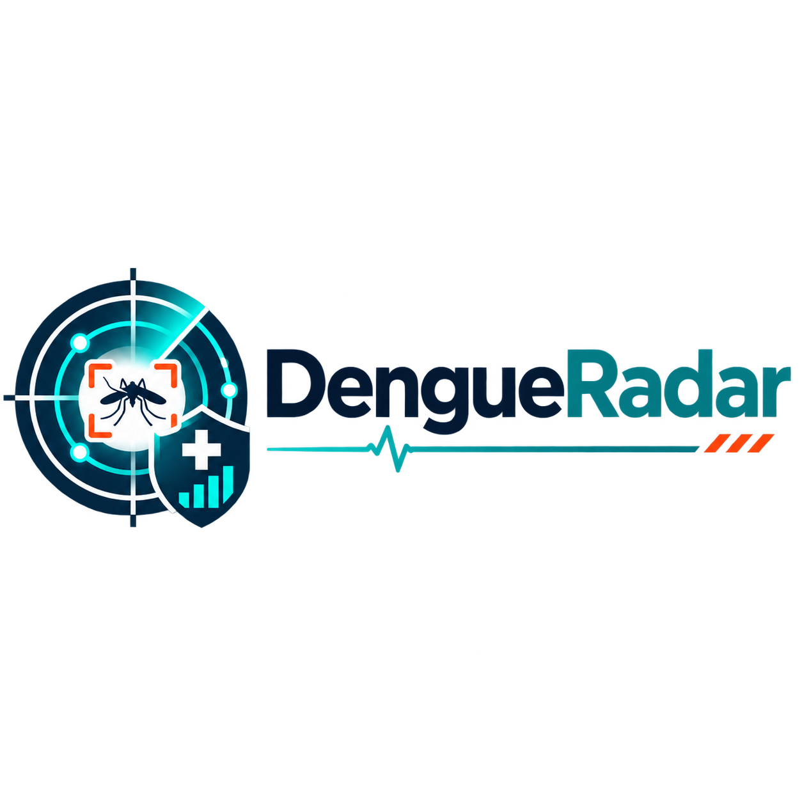
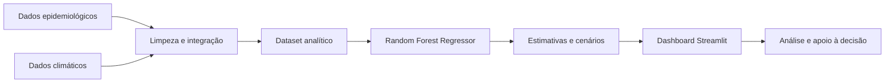

<div align="center">



# 🦟 DengueRadar

### Inteligência epidemiológica para antecipar riscos e apoiar decisões

**Dados públicos · Machine Learning · Visualização territorial · CitizenTech**

[](https://www.python.org/)
[](https://streamlit.io/)
[](https://scikit-learn.org/)
[](https://www.fiap.com.br/)

**[🚀 Acessar o aplicativo](https://dengueradar-bxprd3cqc6vuensylkzhwl.streamlit.app/)** · **[📂 Explorar o código](https://github.com/matheusams19/dengueradar)**

<sub>Protótipo acadêmico de apoio à análise epidemiológica. Não substitui sistemas oficiais de vigilância em saúde.</sub>

</div>

---

## 💡 O problema

A dengue representa um desafio recorrente para a saúde pública. Além de acompanhar o número de notificações, gestores precisam compreender a evolução temporal dos casos, investigar fatores associados ao risco e decidir onde priorizar ações preventivas.

O **DengueRadar** foi desenvolvido para explorar como dados epidemiológicos e climáticos, combinados com técnicas de Ciência de Dados, podem apoiar essas análises em uma interface acessível.

> **Da informação à ação:** explorar o histórico, estimar cenários e comunicar os resultados com clareza — sem confundir projeções estatísticas com casos confirmados.

## 🎯 Objetivo

Construir uma plataforma de **inteligência epidemiológica** que reúna indicadores, projeções experimentais, visualizações geográficas e análises de desempenho de modelos, contribuindo para uma tomada de decisão mais informada.

## ✨ Funcionalidades

| Módulo | O que oferece |
|:--|:--|
| **📊 Visão Geral Epidemiológica** | Indicadores de casos observados e estimados, incidência, classificação de risco e visualização temporal. |
| **🗺️ Inteligência Territorial** | Mapa interativo e ranking de regiões com distribuição espacial **simulada/heurística**, explicitamente identificada como tal. |
| **🌦️ Simulador de Cenários** | Comparação entre condições de referência e valores hipotéticos de temperatura e precipitação. |
| **🧠 Diagnóstico do Modelo** | Visualização de métricas, importância de variáveis e análise de resíduos; a interpretação depende do procedimento de validação utilizado. |
| **📚 Dados e Metodologia** | Descrição das fontes, do processo analítico, das premissas e das limitações do protótipo. |

### Como a plataforma funciona



## 🖥️ Visualização do projeto

A aplicação utiliza **tema escuro (Deep Navy)** e organiza as análises em cinco seções. Para testar a versão publicada:

**➡️ [Abrir o DengueRadar no Streamlit](https://dengueradar-bxprd3cqc6vuensylkzhwl.streamlit.app/)**

> **Dica para o portfólio:** adicione capturas reais em `assets/` (por exemplo, `assets/visao-geral.png`, `assets/radar.png` e `assets/simulador.png`) e inclua-as nesta seção. Evitamos imagens fictícias de dashboards para manter o README fiel ao projeto.

## 🛠️ Tecnologias

<div align="center">

| Camada | Ferramentas |
|:--|:--|
| **Linguagem** | Python |
| **Aplicação web** | Streamlit |
| **Manipulação de dados** | Pandas · NumPy |
| **Machine Learning** | Scikit-learn · Random Forest Regressor |
| **Visualização** | Plotly · mapas do Streamlit |
| **Persistência de modelos** | Joblib |
| **Experimentação** | Jupyter Notebook |

</div>

## 🗃️ Dados e metodologia

O projeto descreve o uso de informações de notificação de dengue provenientes do **SINAN/DATASUS**, acessadas por meio de consultas públicas, e de dados meteorológicos do **INMET** (temperatura e precipitação), integrados por período de análise.

O fluxo analítico contempla:

1. **Preparação dos dados:** leitura, verificação de qualidade, tratamento e integração das bases.
2. **Construção das variáveis:** organização dos registros temporais e dos atributos climáticos utilizados pelo modelo.
3. **Modelagem:** treinamento de um `RandomForestRegressor` para estimar a quantidade de casos.
4. **Avaliação:** análise de erros e comparação entre valores observados e estimados. A capacidade de generalização para semanas futuras deve ser verificada por **validação temporal fora da amostra**.
5. **Visualização:** exploração das previsões, dos cenários hipotéticos e da distribuição territorial ilustrativa.

**Indicadores de qualidade do modelo:** MAE e RMSE são úteis para quantificar o erro, mas seus valores só devem ser divulgados como desempenho preditivo quando calculados em dados de teste independentes do treinamento.

## 📁 Estrutura do repositório

```text
dengueradar/
├── app.py                         # Aplicação Streamlit
├── LogoDengueRadar.png           # Identidade visual
├── requirements.txt              # Dependências Python
├── data/
│   └── processed/                # Dados preparados para análise
├── models/                        # Artefatos do modelo treinado
└── notebooks/
    ├── 01_limpeza_de_dados.ipynb  # Preparação e integração
    └── 02_modelo_ia.ipynb         # Modelagem e avaliação
```

> A disponibilidade de datasets e arquivos `.pkl` depende dos artefatos efetivamente versionados no repositório.

## ⚙️ Instalação e execução local

**Pré-requisitos:** Python 3.10 ou superior e Git.

**1. Clone o projeto**

```bash
git clone https://github.com/matheusams19/dengueradar.git
cd dengueradar
```

**2. Crie e ative um ambiente virtual**

```bash
python -m venv .venv
```

No **Windows (PowerShell)**:

```powershell
.\.venv\Scripts\Activate.ps1
```

No **macOS/Linux**:

```bash
source .venv/bin/activate
```

**3. Instale as dependências**

```bash
pip install -r requirements.txt
```

**4. Confirme os artefatos necessários**

Verifique se o dataset processado e os arquivos do modelo esperados pelo `app.py` estão disponíveis. Caso não estejam, execute os notebooks de preparação e treinamento conforme as entradas necessárias.

**5. Inicie a aplicação**

```bash
streamlit run app.py
```

O Streamlit indicará no terminal o endereço local para abrir no navegador.

## 🔎 Transparência e limitações

Para que a interpretação do projeto seja responsável, considere que:

- **Projeções não são notificações confirmadas.** São estimativas produzidas por um modelo estatístico.
- **Dados públicos podem sofrer atrasos e revisões.** A data e a abrangência das bases influenciam a análise.
- **O mapa territorial é ilustrativo quando usa pesos e coordenadas simuladas.** Não identifica endereços de pacientes nem focos reais do mosquito.
- **Cenários climáticos são hipotéticos.** Mudanças na saída do modelo não demonstram causalidade entre clima e casos.
- **Métricas calculadas sobre dados de treinamento não demonstram desempenho futuro.** A validação temporal é fundamental para avaliar generalização.
- **O sistema não realiza diagnóstico clínico nem substitui protocolos oficiais** de vigilância epidemiológica e saúde pública.

## 🌍 Impacto e ODS

O DengueRadar busca contribuir, como proposta de inovação, para os Objetivos de Desenvolvimento Sustentável:

- **ODS 3 — Saúde e Bem-Estar:** prevenção e apoio à vigilância de doenças.
- **ODS 6 — Água Potável e Saneamento:** atenção às condições ambientais associadas ao risco.
- **ODS 9 — Indústria, Inovação e Infraestrutura:** aplicação de Ciência de Dados à gestão pública.
- **ODS 11 — Cidades e Comunidades Sustentáveis:** informação territorial para planejamento.
- **ODS 16 — Paz, Justiça e Instituições Eficazes:** decisões mais transparentes e orientadas por evidências.

Essas relações representam **contribuições potenciais da solução**, não impactos já mensurados.

## 👥 Equipe

Projeto acadêmico desenvolvido para a **FIAP — Global Solution 2026**, no contexto de **CitizenTech**.

**Matheus Alexandre** · **Sabrina Fraguela**

---

<div align="center">

**DengueRadar — dados que ajudam a compreender riscos, informação que apoia decisões.**

[🔝 Voltar ao topo](#-dengueradar)

</div>
